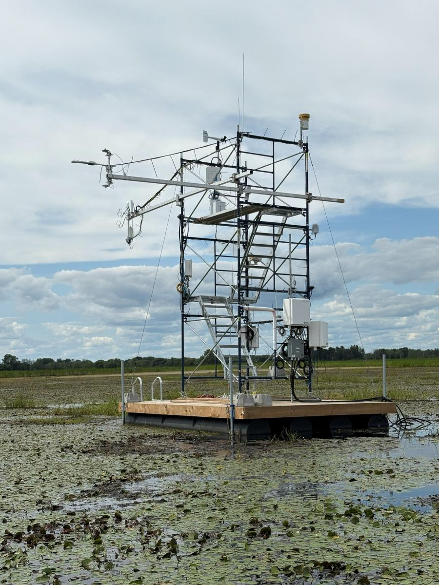
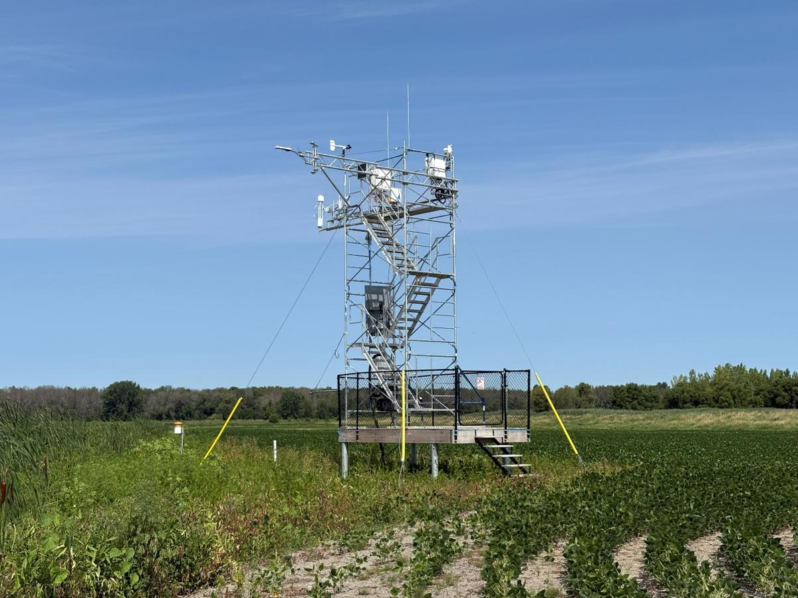
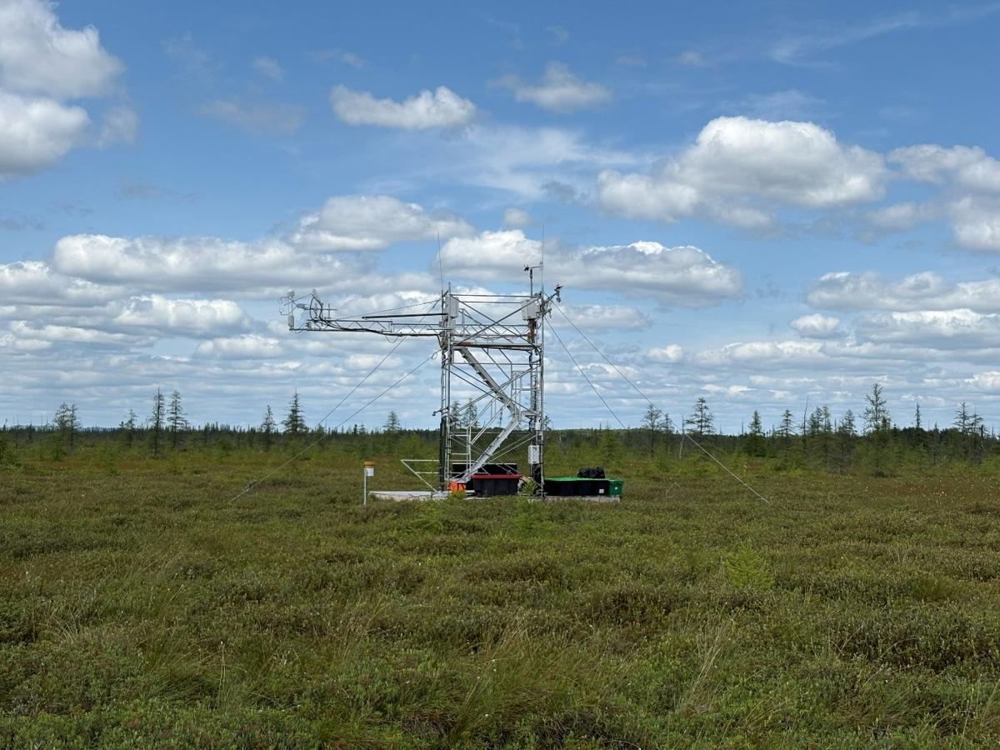
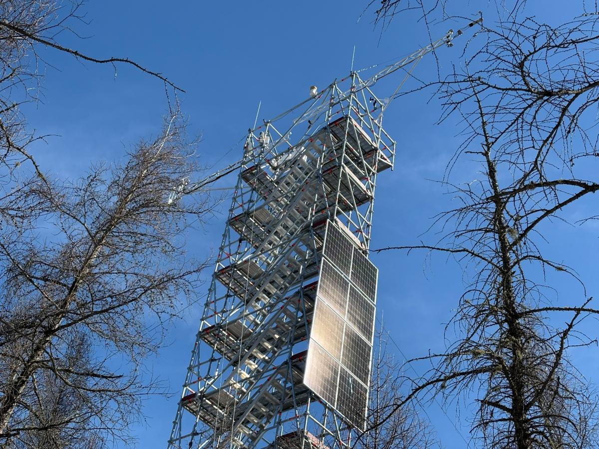
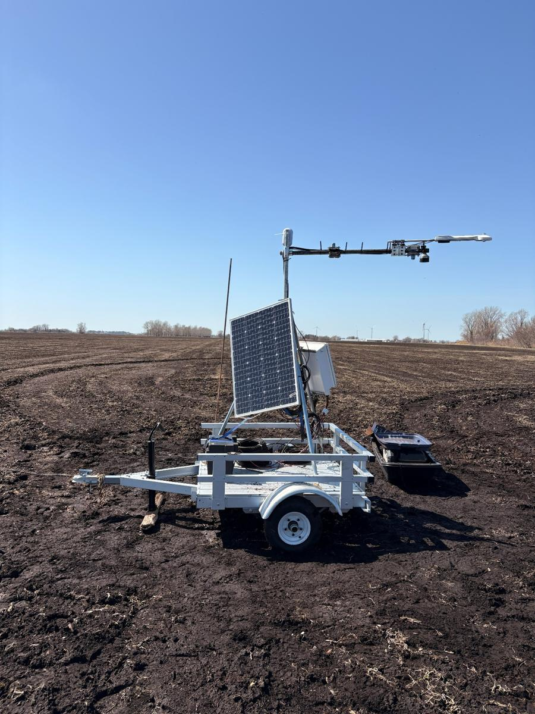
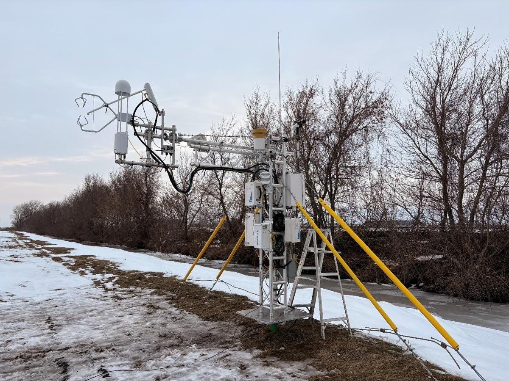
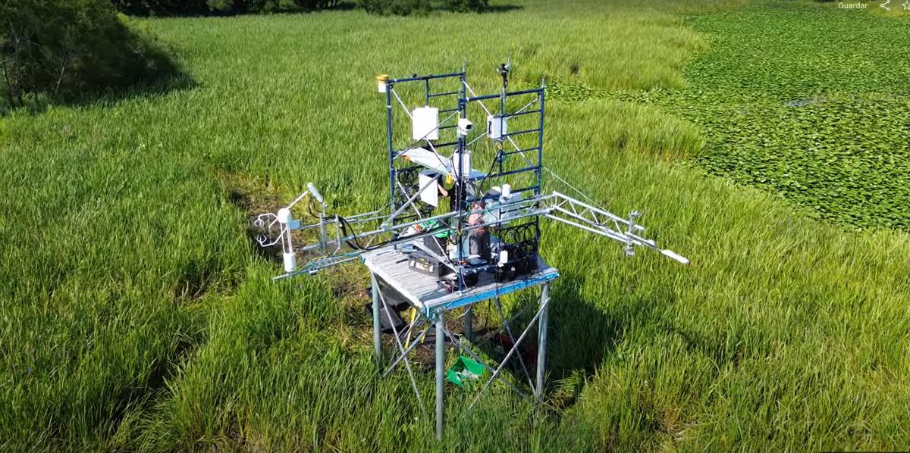

# Sites and towers

Six eddy-covariance flux towers of the Carbonique project (carbon dynamics in southern Quebec wetlands). Site details come from the Word document *Info on Carbonique EC sites.docx* (parsed 2026-09-24, corrected 2026-09-29); field-note counts are as of 2026-09-17.

## All sites at a glance

| Code | Site name | AmeriFlux ID | Coordinates | Active since | Field notes | Faults |
|---|---|---|---|---|---|---|
| McGill_1 | Lac Saint-Pierre Restored Marsh | CA-CQ9 | 46.1488; -72.7268 | 2025-07-31 | 26 | 12 |
| UQAM_1 | Lac Saint-Pierre Disturbed Marsh | CA-CQ1 | 46.1645; -72.6850 | 2024-07-19 | 33 | 10 |
| UQAM_2 | Natural Lac-à-la-Tortue Open bog | CA-CQ2 | 46.5315; -72.6450 | 2025-04-15 | 22 | 5 |
| UQAM_3 | Carbonique Lac-à-la-Tortue Forested bog | CA-CQ3 | 46.5280; -72.6462 | 2025-04-10 | 25 | 12 |
| UQAM_4 | Saint-Remi Disturbed Forested Peatland | CA-CQ4 | 45.2458; -73.6823 | 2026-01-14 | 18 | 5 |
| UQAM_5 | Saint-François du Lac Natural Marsh | CA-CQ5 | 46.0886; -72.9117 | 2026-03-10 | 3 | 0 |

## McGill_1 — Lac Saint-Pierre Restored Marsh

*Document heading:* MCGILL_1 Lac Saint-Pierre, Quebec (46.1488N, 72.7268W)  
*Place:* Lac Saint-Pierre, Quebec · *Lat/Lon:* 46.1488, -72.7268 · *Active since:* 2025-07-31

**Summary (maintenance-log view):** Restored marsh near Lac Saint-Pierre. Access by boat across the marsh; site sits on National Defence land, so visits depend on an access permit.

It is a restored marsh near Lac Saint-Pierre, about 3.7 km southwest of UQAM_1. The tower stands on a floating platform in the marsh and is reached by boat, or on foot over the ice in winter. The site is on National Defence land, so every visit needs an access permit. It is powered by solar panels and a battery bank.

  

### Site info

- **Site name:** Lac Saint-Pierre Restored Marsh
- **AmeriFlux ID:** CA-CQ9
- **Location:** Baie-du-Febvre, Quebec
- **Coordinates:** 46.1488 N, 72.7268 W
- **Canopy height set in SmartFlux:** 0.05 m
- **Station active since:** 2025-07-31
- **Tower:** scaffolding on a floating platform in the marsh, re-levelled after the ice melt and during maintenance visits
- **Power:** off-grid, solar panels and battery bank

### Instruments info

#### Sonic anemometer

- **Model:** Campbell Scientific CSAT3B
- **Sonic height:** 4.55 m
- **North offset:** 290°

#### CO2/H2O gas analyzer

- **Model:** LI-7200RS (enclosed path) with heated intake tube and 7200-102 flow module
- **Northward separation:** -3.8 cm
- **Eastward separation:** 9 cm
- **Vertical separation:** 0 cm

#### CH4 gas analyzer

- **Model:** LI-7700 (open path)
- **Northward separation:** 10 cm
- **Eastward separation:** 37 cm
- **Vertical separation:** 1 cm

#### Temperature and humidity probes

- **Model:** Both are HygroVue10
- **TA_1_1_1, RH_1_1_1 (upper):** 4.5m
- **TA_1_2_1, RH_1_2_1 (lower):** 2m

#### Wind Monitor

- **Model:** RM Young 05103
- **Variables:** WS_1_1_1, WD_1_1_1
- **Height:** 5m

#### Digital Barometric Pressure sensor

- **Model:** BaroVue10
- **Variable:** PA_1_1_1

#### Tipping Bucket Rain Gauge

- **Model:** Texas Electronics TE525WS
- **Variable:** P_RAIN_1_1_1

#### Sonic Ranging Sensor for Snow Depth

- **Model:** SnowVue10
- **Variable:** D_SNOW
- **Height:** 4m

#### Net Radiometer

- **Model:** Kipp & Zonen CNR4 with CNF4 ventilation unit
- **Variables:** SW_IN, SW_OUT, LW_IN, LW_OUT, NETRAD, ALB
- **Height:** 4.5 m

#### Full-spectrum Quantum Sensor

- **Model:** Apogee SQ-521 (2 sensors, incoming and outgoing)
- **Variables:** PPFD_IN, PPFD_OUT

#### Water and Sediment Temperature Profile

- Thermocouples in a PVC pipe beside the platform (installed 2025-09-25)
- **Variables:** TW_1_1_1 to TW_1_5_1, TS_1_1_1 to TS_1_3_1
- **Depths:** TW_1_1_1 100cm from the bottom, TW_1_2_1 50cm from the bottom, TW_1_3_1 20cm from the bottom, TW_1_4_1 10cm from the bottom, TW_1_5_1 5cm from the bottom. TS_1_1_1 5cm below the ground, TS_1_2_1 10cm below the ground, TS_1_3_1 20cm below the ground. It was not possible to dig further so TS_1_4_1 should not be considered.
- **Renamed:** TW_1_5_1 was logged as TW_5_1_1 until 2026-09-28 11:30 (renamed in the logger at 11:40; the 12:00 record is the first under the new name)

#### Water Level Sensor

- **Model:** Campbell Scientific CS456 vented pressure transducer (0 to 7.25 psig)
- **Serial number:** not recorded
- **Installed:** 2026-05-28
- **Type:** stage sensor in open water, measuring the water column above the lake bed
- **Sensor position:** 0.16 m above the bed, so its depth relative to the bed surface is -0.16 m
- **Variable:** WTD_1_1_1 = Lvl_psi_Avg × 0.70307 + 0.16 m
- **Valid data from:** 2026-05-28 11:00
- **Water level in 2026:** +0.87 to +1.01 m above the bed (positive = water above the surface)
- **Logger offset in the cal file:** 1.58 m (wrong, do not use Lvl_m_Avg)
- **Before the CS456:** WTD_1_1_1 came from the EasyProbe level channel, which does not measure the water level

#### Water Multiprobe

- **Water multiprobe:** Eureka EasyProbe 20 (since 2025-09-05; removed for the winter on 2025-11-10 and reinstalled on 2026-04-23)

### Processing settings

- **EC raw data:** 20 Hz, stored in 30 min .ghg files by the SmartFlux 2
- **Biomet variables sent to the SmartFlux:** TA_1_1_1, RH_1_1_1, PA_1_1_1

## UQAM_1 — Lac Saint-Pierre Disturbed Marsh

*Document heading:* UQAM_1 Lac Saint-Pierre, Quebec (46.1645N, 72.6851W)  
*Place:* Lac Saint-Pierre, Quebec · *Lat/Lon:* 46.1645, -72.6851 · *Active since:* 2024-07-19

**Summary (maintenance-log view):** Disturbed marsh used as an agricultural site (soy). The oldest tower in the network and the reference installation for the others.

It is a transformed marsh near Lac Saint-Pierre that is used as an agricultural site. There is an interannual crop rotation between Glycine max and Zea mays. The water in the field is regulated with pumps.

  

### Site info

- **Site name:** Lac Saint-Pierre Disturbed Marsh
- **AmeriFlux ID:** CA-CQ1
- **Location:** Baie-du-Febvre, Quebec
- **Coordinates:** 46.1645 N, 72.6851 W
- Canopy height set in SmartFlux is not representative of the site at all times, it is an agricultural site, so the canopy height is dynamic, we have canopy height measurements.
- **Station active since:** 2024-07-19 (system installed 8 to 16 July 2024)
- **Tower:** scaffolding tower, with the EC sensors on a retractable outrigger
- **Power:** AC line, on a circuit separate from the farm pumps
- **Phenocam:** phenocam.nau.edu/webcam/sites/lspdisturbedmarsh

### Instruments info

#### Sonic anemometer

- **Model:** Campbell Scientific CSAT3B
- **Sonic height:** 7.11 m
- **North offset:** 285°

#### CO2/H2O gas analyzer

- **Model:** LI-7200RS (enclosed path) with heated intake tube and 7200-102 flow module
- **Northward separation:** -4 cm
- **Eastward separation:** -9 cm
- **Vertical separation:** 0 cm

#### CH4 gas analyzer

- **Model:** LI-7700 (open path)
- **Northward separation:** -21 cm
- **Eastward separation:** -28 cm
- **Vertical separation:** 1 cm

#### Temperature and humidity probes

- **Model:** Both are HygroVue10
- **TA_1_1_1, RH_1_1_1:** 7.1 m
- **TA_1_2_1, RH_1_2_1:** 2 m

#### Wind Monitor

- **Model:** RM Young 05103
- **Variables:** WS_1_1_1, WD_1_1_1
- **Height:** 8 m (on top of the scaffolding)

#### Digital Barometric Pressure sensor

- **Model:** BaroVue10
- **Variable:** PA_1_1_1

#### Tipping Bucket Rain Gauge

- **Model:** Texas Electronics TE525WS
- **Variable:** P_RAIN_1_1_1
- **Mounting:** on a pole on the ground at installation; the 2026-05-07 field note says it was fixed at the top of the tower

#### Sonic Ranging Sensor for Snow Depth

- **Model:** SnowVue10
- **Variable:** D_SNOW
- **Height:** 2.2 m

#### Weighing Precipitation Gauge

- **Model:** OTT Pluvio2 L 400
- On its own structure with a solar panel and batteries, installed in June 2026

#### Net Radiometer

- **Model:** Kipp & Zonen CNR4 with CNF4 ventilation unit
- **Variables:** SW_IN, SW_OUT, LW_IN, LW_OUT, NETRAD, ALB
- **Height:** 7 m
- Facing 190° from north

#### Full-spectrum Quantum Sensor

- **Model:** Apogee SQ-521 (2 sensors, incoming and outgoing)
- **Variables:** PPFD_IN, PPFD_OUT

#### Soil Heat Flux Plates

- **Model:** Hukseflux HFP01 (4 sensors)
- Depth 8 cm, at 50 cm and 100 cm on both sides of the CS650 profile
- **Variables:** G_1_1_1 to G_4_1_1

#### Soil Moisture and Temperature Probes

- **Model:** CS650 (5 horizontal sensors, 4 in profile, a total of 8 because there is one that goes in the horizontal and it is the first of the profile ones.)
- **Horizontal replicas depth 8 cm:** SWC_2_1_1 to SWC_5_1_1 and TS_2_1_1 to TS_5_1_1 (added 2025-08-05)
- **Vertical profile:** 8 cm, 16 cm, 32 cm, 64 cm: SWC_1_1_1 to SWC_1_4_1 and TS_1_1_1 to TS_1_4_1

#### Water Table Depth Sensor

- **Model:** Campbell Scientific CS456 vented pressure transducer (0 to 7.25 psig)
- **Serial number:** 70010295
- **Installed:** 2026-05-07
- **Sensor depth below the surface:** not measured yet
- **Data:** only about three weeks, in May 2026; the channel reads NAN in the current logger table
- **Logger offset in the cal file:** 1.17 m, never checked
- **Next visit:** measure the cable drop and check the wiring

### Processing settings

- **EC raw data:** 20 Hz, stored in 30 min .ghg files by the SmartFlux 2
- **Biomet variables sent to the SmartFlux:** TA_1_1_1, RH_1_1_1, PA_1_1_1

## UQAM_2 — Natural Lac-à-la-Tortue Open bog

*Document heading:* UQAM_2 Lac-à-la-Tortue, Quebec (46.5316N, 72.6450W)  
*Place:* Lac-à-la-Tortue, Quebec · *Lat/Lon:* 46.5316, -72.645 · *Active since:* 2025-04-15

**Summary (maintenance-log view):** Natural open bog (Sphagnum). Solar-powered; access on foot over peat, so a plank boardwalk was added in 2026.

It is a natural open bog near Lac-à-la-Tortue. The vegetation is dominated by Sphagnum mosses with Chamaedaphne calyculata, Trichophorum cespitosum and Rhododendron groenlandicum. The site is off-grid (solar powered) and is reached on foot over the peat. It is about 400 m north of UQAM_3.

  

### Site info

- **Site name:** Natural Lac-à-la-Tortue Open bog
- **AmeriFlux ID:** CA-CQ2
- **Location:** Notre-Dame-du-Mont-Carmel, Quebec
- **Coordinates:** 46.5316 N, 72.6450 W
- **Canopy height set in SmartFlux:** 0.2 m (displacement height 0.134 m, roughness length 0.03 m)
- **Station active since:** 2025-04-15 (EC sensors reinstalled on 2025-07-02)
- **Tower:** EC sensors on a boom that can be pulled in for maintenance
- **Power:** off-grid, solar panels and battery bank

### Instruments info

#### Sonic anemometer

- **Model:** Campbell Scientific CSAT3B
- **Sonic height:** 4.80 m
- **North offset:** 264°

#### CO2/H2O gas analyzer

- **Model:** LI-7200RS (enclosed path) with 7200-102 flow module
- **Northward separation:** 1 cm
- **Eastward separation:** 1 cm
- **Vertical separation:** -1 cm

#### CH4 gas analyzer

- **Model:** LI-7700 (open path)
- **Northward separation:** -25 cm
- **Eastward separation:** -26 cm
- **Vertical separation:** 0 cm

#### Temperature and humidity probes

- **Model:** Both are HygroVue10
- **TA_1_1_1, RH_1_1_1 (upper):** 4.8 m
- **TA_1_2_1, RH_1_2_1 (lower):** 2 m

#### Wind Monitor

- **Model:** RM Young 05103
- **Variables:** WS_1_1_1, WD_1_1_1
- **Height:** 5.2 m

#### Digital Barometric Pressure sensor

- **Model:** BaroVue10
- **Variable:** PA_1_1_1

#### Tipping Bucket Rain Gauge

- **Model:** Texas Electronics TE525WS
- **Variable:** P_RAIN_1_1_1

#### Sonic Ranging Sensor for Snow Depth

- **Model:** SnowVue10
- **Variable:** D_SNOW
- **Height:** 2m

#### Net Radiometer

- **Model:** Kipp & Zonen CNR4 with CNF4 ventilation unit
- **Variables:** SW_IN, SW_OUT, LW_IN, LW_OUT, NETRAD, ALB
- **Height:** 5 m

#### Full-spectrum Quantum Sensor

- **Model:** Apogee SQ-521 (2 sensors, incoming and outgoing)
- **Variables:** PPFD_IN, PPFD_OUT

#### Soil Heat Flux Plates

- **Model:** Hukseflux HFP01 (4 sensors)
- Depth 8 cm
- **Variables:** G_1_1_1 to G_4_1_1

#### Soil Moisture and Temperature Probes

- **Model:** CS650 (8 sensors: 4 in the vertical profile and 4 horizontal replicas)
- **Vertical profile:** 8 cm, 16 cm, 32 cm, 64 cm: SWC_1_1_1 to SWC_1_4_1 and TS_1_1_1 to TS_1_4_1
- **Horizontal replicas depth 8 cm:** SWC_2_1_1 to SWC_5_1_1 and TS_2_1_1 to TS_5_1_1
- Positions and serial numbers rechecked in the field on 2026-08-20

#### Water Table Depth Sensor

- **Model:** Campbell Scientific CS456 vented pressure transducer (0 to 7.25 psig)
- **Serial number:** 70010296
- **Installed:** 2026-04-27 (data start that day at 13:30; recorded in the written installation note, not in the EcoFlux field notes)
- **Sensor depth below the surface:** 2.05 m, measured at installation (written installation note)
- **Water table at installation:** 0.13 m below the surface
- **Variable:** WTD_1_1_1 = Lvl_psi_Avg × 0.70307 - 2.05 m
- **Valid data from:** 2026-04-28 00:00 (the sensor was still settling before)
- **Water table in 2026:** -0.20 to -0.05 m
- **Logger offset in the cal file:** 0.79 m (wrong, do not use Lvl_m_Avg)

### Processing settings

- **EC raw data:** 20 Hz, stored in 30 min .ghg files by the SmartFlux 2
- **Biomet variables sent to the SmartFlux:** TA_1_1_1, RH_1_1_1, PA_1_1_1

## UQAM_3 — Carbonique Lac-à-la-Tortue Forested bog

*Document heading:* UQAM_3 Lac-à-la-Tortue, Quebec (46.5280N, 72.6462W)  
*Place:* Lac-à-la-Tortue, Quebec · *Lat/Lon:* 46.528, -72.6462 · *Active since:* 2025-04-10

**Summary (maintenance-log view):** Natural forested bog. Powered by an EFOY methanol fuel-cell hybrid system, which has been the site's main source of trouble.

It is a natural forested bog near Lac-à-la-Tortue, about 400 m south of UQAM_2. The EC system is on a tall tower above the tree canopy. The site is off-grid and powered by an EFOY methanol fuel cell hybrid system with solar panels.

  

### Site info

- **Site name:** Carbonique Lac-à-la-Tortue Forested bog
- **AmeriFlux ID:** CA-CQ3
- **Location:** Notre-Dame-du-Mont-Carmel, Quebec
- **Coordinates:** 46.5280 N, 72.6462 W
- **Canopy height set in SmartFlux:** 12.6 m (displacement height 8.44 m, roughness length 1.89 m)
- **Station active since:** 2025-04-10
- **Tower:** tall tower, certified every year by a structural engineer
- **Power:** off-grid, EFOY methanol fuel cell with battery bank

### Instruments info

#### Sonic anemometer

- **Model:** Campbell Scientific CSAT3B
- **Sonic height:** 21.9 m
- **North offset:** 332°

#### CO2/H2O gas analyzer

- **Model:** LI-7200RS (enclosed path) with 7200-102 flow module
- **Northward separation:** 10 cm
- **Eastward separation:** 2 cm
- **Vertical separation:** 0 cm

#### CH4 gas analyzer

- **Model:** LI-7700 (open path)
- **Northward separation:** -30 cm
- **Eastward separation:** 15 cm
- **Vertical separation:** -2 cm

#### Temperature and humidity probes

- **Model:** HygroVue10 (4 sensors)
- **TA_1_1_1, RH_1_1_1 (top):** 22 m
- **TA_1_2_1, RH_1_2_1 (second from the top):** 16 m
- **TA_1_3_1, RH_1_3_1 (third from the top):** 9 m
- **TA_1_4_1, RH_1_4_1 (lowest level, near the surface):** 2 m

#### Wind Monitor

- **Model:** RM Young 05103
- **Variables:** WS_1_1_1, WD_1_1_1
- **Height:** 24 m

#### Digital Barometric Pressure sensor

- **Model:** BaroVue10
- **Variable:** PA_1_1_1

#### Tipping Bucket Rain Gauge

- **Model:** Texas Electronics TE525WS
- **Variable:** P_RAIN_1_1_1

#### Sonic Ranging Sensor for Snow Depth

- **Model:** SnowVue10
- **Variable:** D_SNOW
- **Height:** 1.68 m

#### Net Radiometer

- **Model:** Kipp & Zonen CNR4 with CNF4 ventilation unit
- **Variables:** SW_IN, SW_OUT, LW_IN, LW_OUT, NETRAD, ALB
- **Height:** 22 m

#### Full-spectrum Quantum Sensor

- **Model:** Apogee SQ-521 (2 sensors, incoming and outgoing)
- **Variables:** PPFD_IN, PPFD_OUT

#### Soil Heat Flux Plates

- **Model:** Hukseflux HFP01 (4 sensors)
- **Depth:** 8 cm
- **Variables:** G_1_1_1 to G_4_1_1

#### Soil Moisture and Temperature Probes

- **Model:** CS650 (8 sensors: 4 in the vertical profile and 4 horizontal replicas)
- **Vertical profile:** 8 cm, 16 cm, 32 cm, 64 cm: SWC_1_1_1 to SWC_1_4_1 and TS_1_1_1 to TS_1_4_1
- **Horizontal replicas depth 8 cm:** SWC_2_1_1 to SWC_5_1_1 and TS_2_1_1 to TS_5_1_1
- Positions and serial numbers rechecked in the field on 2026-08-20

#### Water Table Depth Sensor

- **Model:** Campbell Scientific CS456 vented pressure transducer (0 to 7.25 psig)
- **Serial number:** 70010297
- **Installed:** 2026-04-15, in a tube 309 cm long with 110 cm above the ground; logging from 2026-04-21 after the program change
- **Sensor depth below the surface:** 1.83 m, from the water table measured at 11.5 cm below the surface (to confirm: a reading of 0.24 m was also reported, which gives 1.96 m)
- **Variable:** WTD_1_1_1 = Lvl_psi_Avg × 0.70307 - 1.83 m
- **Valid data from:** 2026-04-21 16:00
- **Water table in 2026:** +0.11 m in April (ponding at snowmelt) down to -0.49 m by mid-September
- **Logger offsets used so far:** 0.00, 1.75 and 1.48 m (all wrong, do not use Lvl_m_Avg)

#### Profile System

- Intakes and tubing at 4 levels on the tower.
- **Intake heights:** 2 m, 9m, 16m, 22m

### Processing settings

- **EC raw data:** 20 Hz, stored in 30 min .ghg files by the SmartFlux 2
- **Biomet variables sent to the SmartFlux:** TA_1_1_1, RH_1_1_1, PA_1_1_1

## UQAM_4 — Saint-Remi Disturbed Forested Peatland

*Document heading:* UQAM_4 Saint-Rémi, Quebec (45.2459N, 73.6823W)  
*Place:* Saint-Rémi, Quebec · *Lat/Lon:* 45.2459, -73.6823 · *Active since:* 2026-01-14

**Summary (maintenance-log view):** Disturbed peatland used as an agricultural site (lettuce). Two systems: a fixed AC-powered tower on the berm and a solar rover tripod on a trailer that moves in and out of the field around planting.

It is a transformed forested peatland near Saint-Rémi that is used as an agricultural site. The station has two parts: a fixed tower on the berm at the edge of the field, powered by AC, that carries the EC system and part of the meteorological sensors, and a rover tripod on a trailer inside the field, powered by a solar panel, that carries the radiation, snow and soil sensors. The trailer is moved out of the field for planting and harvest, so the outgoing radiation and soil data do not represent the field during those periods.

  
  

### Site info

- **Site name:** Saint-Remi Disturbed Forested Peatland
- **AmeriFlux ID:** CA-CQ4
- **Location:** Saint-Rémi, Quebec
- **Coordinates:** 45.2459 N, 73.6823 W
- **Canopy height set in SmartFlux:** A dynamic canopy that varies between no plants to 40cm height ones. It needs modelling to rerun the flux calculations.
- **Station active since:** 2026-01-14
- **Tower:** fixed tower on the berm with a foldable boom (since 2026-05-08)
- **Power:** tower on AC; rover tripod on a solar power.
- **Dataloggers:** CR1000X on the tower (tables UQAM_4_*) and a second CR1000X on the tripod (tables UQAM_4b_*)
- **Phenocam:** phenocam.nau.edu/webcam/sites/strdisturbedforestedpeatland

### Instruments info

#### Sonic anemometer

- **Model:** Campbell Scientific CSAT3B
- **Sonic height:** 2.86 m
- **North offset:** 213° (it was 230° in February 2026)

#### CO2/H2O gas analyzer

- **Model:** LI-7200RS (enclosed path) with 7200-102 flow module
- **Northward separation:** -8 cm
- **Eastward separation:** -4 cm
- **Vertical separation:** 0 cm

#### CH4 gas analyzer

- **Model:** LI-7700 (open path)
- **Northward separation:** 30 cm
- **Eastward separation:** 25 cm
- **Vertical separation:** -10 cm

#### Temperature and humidity probes

- **Model:** Both are HygroVue10 (on the tower)
- **TA_1_1_1, RH_1_1_1 (upper):** 2.8m
- **TA_1_2_1, RH_1_2_1 (lower):** 2m

#### Wind Monitor

- **Model:** RM Young 05103
- **Variables:** WS_1_1_1, WD_1_1_1
- **Height:** 3m

#### Digital Barometric Pressure sensor

- **Model:** BaroVue10
- **Variable:** PA_1_1_1

#### Tipping Bucket Rain Gauge

- **Model:** Texas Electronics TE525WS
- **Variable:** P_RAIN_1_1_1

#### Sonic Ranging Sensor for Snow Depth

- **Model:** SnowVue10
- **Variable:** D_SNOW
- **Height:** around 2m but since it is a rover station it varies.

#### Net Radiometer

- **Model:** Kipp & Zonen CNR4 with CNF4 ventilation unit
- **Variables:** SW_IN, SW_OUT, LW_IN, LW_OUT, NETRAD, ALB
- **Height:** 2m
- On the rover tripod

#### Full-spectrum Quantum Sensor

- **Model:** Apogee SQ-521 (2 sensors, incoming and outgoing)
- **Variables:** PPFD_IN, PPFD_OUT

#### Soil Heat Flux Plates

- **Model:** Hukseflux HFP01 (4 sensors, on the rover tripod)
- **Depth:** 5cm

#### Soil Moisture and Temperature Probes

- **Model:** CS650 (4 sensors, on the rover tripod, corresponding to the CS650_2_1_1, CS650_3_1_1, CS650_4_1_1, CS650_5_1_1 variables)
- **Depth:** 5cm
- **Soil profile:** Campbell Scientific SoilVUE10 (0.5 m length) corresponding to the variables SoilVue_1_1_1 (5cm), SoilVue_1_2_1 (15cm), SoilVue_1_3_1 (25cm), SoilVue_1_4_1(35cm), SoilVue_1_5_1(45cm), SoilVue_1_6_1 (55cm)

#### Water Table Depth Sensor

- **Model:** Campbell Scientific CS456 vented pressure transducer (0 to 7.25 psig)
- **Serial number:** 70010299
- **Installed:** 2026-05-15, in a hole 2.70 m deep; water was struck at 1.85 m while augering
- **Sensor depth below the surface:** 3.15 m, provisional: it cannot be deeper than the 2.70 m hole, so measure the cable drop on the next visit
- **Variable:** WTD_1_1_1 = Lvl_psi_Avg × 0.70307 - 3.15 m
- **Valid data from:** 2026-05-16
- **Water table in 2026:** -2.16 to -1.56 m with the provisional depth (-1.75 to -1.10 m if the depth is 2.70 m)
- **Logger offset in the cal file:** -1.57 m (wrong sign, do not use Lvl_m_Avg)
- **Before the CS456:** WTD_1_1_1 came from the EasyProbe level channel, which does not measure the water table

#### Water Multiprobe

- **Water multiprobe:** Eureka EasyProbe 20 in the canal beside the field that feeds the crops (since 2026-04-17)

### Processing settings

- **EC raw data:** 20 Hz, stored in 30 min .ghg files by the SmartFlux 2
- **Biomet variables sent to the SmartFlux:** TA_1_1_1, RH_1_1_1, PA_1_1_1
- **Met data:** tower tables UQAM_4_Met_30m and UQAM_4_Met_05m; tripod radiation in UQAM_4b_Met_05m

## UQAM_5 — Saint-François du Lac Natural Marsh

*Document heading:* UQAM_5 Saint-François-du-Lac, Quebec (46.0886N, 72.9174W)  
*Place:* Saint-François-du-Lac, Quebec · *Lat/Lon:* 46.0886, -72.9174 · *Active since:* 2026-03-10

**Summary (maintenance-log view):** Natural marsh that floods each spring (up to 3 m). Newest site: the eddy covariance system was commissioned in August 2026.

It is a natural marsh near Saint-François-du-Lac that floods every spring, with water reaching up to 3 m in extreme events. The station sits on two wooden platforms on certified screw piles 3 m above the ground: one for the solar panels and battery bank, the other for the scaffolding tower and equipment. Access may require a boat during floods and a couple of kilometres of walking in winter.

  

### Site info

- **Site name:** Saint-François du Lac Natural Marsh
- **AmeriFlux ID:** CA-CQ5
- **Location:** Saint-François-du-Lac, Quebec
- **Coordinates:** 46.0886 N, 72.9174 W
- **Canopy height set in SmartFlux:** 1 m
- **Station active since:** platforms installed in fall 2025, EC system installed 20 July to 11 August 2026
- **Valid data from:** 2026-08-06 16:00
- **Power:** off-grid, solar panels and battery bank
- **Phenocam:** phenocam.nau.edu/webcam/sites/lspnaturalmarsh

### Instruments info

#### Sonic anemometer

- **Model:** Campbell Scientific CSAT3B
- **Sonic height:** 4.85 m
- **North offset:** 267°

#### CO2/H2O gas analyzer

- **Model:** LI-7200RS (enclosed path) with 7200-102 flow module
- **Northward separation:** 2 cm
- **Eastward separation:** 15 cm
- **Vertical separation:** 4 cm

#### CH4 gas analyzer

- **Model:** LI-7700 (open path)
- **Northward separation:** 30 cm
- **Eastward separation:** 25 cm
- **Vertical separation:** -5 cm

#### Temperature and humidity probes

- **Model:** Both are HygroVue10
- **TA_1_1_1, RH_1_1_1 (upper):** 4.85 m
- **TA_1_2_1, RH_1_2_1 (lower):** 3.5 m

#### Wind Monitor

- **Model:** RM Young 05103
- **Variables:** WS_1_1_1, WD_1_1_1
- **Height:** 5 m

#### Digital Barometric Pressure sensor

- **Model:** BaroVue10
- **Variable:** PA_1_1_1

#### Tipping Bucket Rain Gauge

- **Model:** Texas Electronics TE525WS
- **Variable:** P_RAIN_1_1_1

#### Sonic Ranging Sensor for Snow Depth

- **Model:** SnowVue10
- **Variable:** D_SNOW
- **Height:** To be checked m

#### Net Radiometer

- **Model:** Kipp & Zonen CNR4 with CNF4 ventilation unit
- **Variables:** SW_IN, SW_OUT, LW_IN, LW_OUT, NETRAD, ALB
- **Height:** 4.8 m

#### Full-spectrum Quantum Sensor

- **Model:** Apogee SQ-521 (2 sensors, incoming and outgoing)
- **Variables:** PPFD_IN, PPFD_OUT

#### Soil Heat Flux Plates

- **Model:** Hukseflux HFP01 (4 sensors)
- Horizontal replicas 8 cm below the surface
- **Variables:** G_1_1_1 to G_4_1_1

#### Soil Moisture and Temperature Probes

- **Model:** CS650 (4 sensors)
- **Horizontal replicas 5 cm below the surface:** SWC_1_1_1 to SWC_4_1_1 and TS_1_1_1 to TS_4_1_1
- **No vertical profile yet:** the site was too flooded to dig, to be installed when it dries

### Processing settings

- **EC raw data:** 20 Hz, stored in 30 min .ghg files by the SmartFlux 2
- **Biomet variables sent to the SmartFlux:** TA_1_1_1, RH_1_1_1, PA_1_1_1

## Setup common to all sites

### Variable names

- Names follow the AmeriFlux convention VAR_H_V_R (horizontal position, vertical level, replicate).
- **For air sensors, level 1 is the highest:** TA_1_1_1 and RH_1_1_1 are always the upper HygroVue10.
- For soil, SWC_1_1_1 to SWC_1_4_1 and TS_1_1_1 to TS_1_4_1 are the vertical profile from shallow to deep, and the _2_1_1 to _5_1_1 sensors are horizontal replicas.

### Time and data acquisition

- All loggers and SmartFlux units record in EST (UTC-5) all year, with no daylight saving time.
- **Datalogger:** Campbell Scientific CR1000X running the same program at every site, with the site-specific calibrations in a .cal file on the CPU drive.
- The EC instruments are powered through an SDM-CD16ACA relay controller.

### SmartFlux real-time processing

- **Averaging period:** 30 min
- **Tilt correction:** double rotation
- **Detrending:** block averaging
- **Time lag:** covariance maximisation with default
- Densities converted to mixing ratios before computing fluxes
- **Spectral corrections:** Moncrieff et al. (2004) high-pass and Moncrieff et al. (1997) low-pass
- **Footprint:** Kljun et al. (2004)
- **Quality flags:** Mauder and Foken (2004), 0-1-2 system

### Water table depth

- **Sensor:** Campbell Scientific CS456 vented pressure transducer. It reads gauge pressure, so it needs no barometric correction (checked against station pressure at UQAM_2 and UQAM_3)
- **Sign convention (AmeriFlux):** positive = water above the surface, negative = below it
- **Head above the sensor:** Lvl_psi_Avg × 0.70307 m of water
- WTD_1_1_1 = head - sensor depth below the surface, applied in first stage as a dated calibration (recommended ini files of 2026-09-23). The offsets in the logger .cal files, and so Lvl_m_Avg, are not reliable
- The EasyProbe level channel (L_WATER_Avg) is not a water table measurement

### Winter shutdown of the water sensors

- At every site the CS456 pressure transducers (WTD) and the EasyProbe water multiprobes are disconnected for the winter, because they get damaged when the water gets close to 0 °C.
- **Data while disconnected:** not a measurement: exclude it in first stage, one dated window per winter
- **At reinstallation:** re-measure the CS456 depth and add a new dated calibration row; the previous season's datum does not carry over

### Sources and where to find the files

- Sonic heights, north offsets, separations, tube settings and canopy heights come from the SmartFlux metadata (the .metadata file inside each .ghg).
- **Raw EC files:** \Sites\<SITE>\HighFrequencyData\raw\YYYY\MM
- **SmartFlux summaries:** \Sites\<SITE>\Flux
- **Met logger files:** Sites\<SITE>\Met
- **Database INI files and third stage config:** \Database\Calculation_Procedures\TraceAnalysis_ini\<SITE>
- **Field notes, site list and equipment inventory:** EcoFlux Inventory (grandwazoo.ddns.net/ecoflux)
