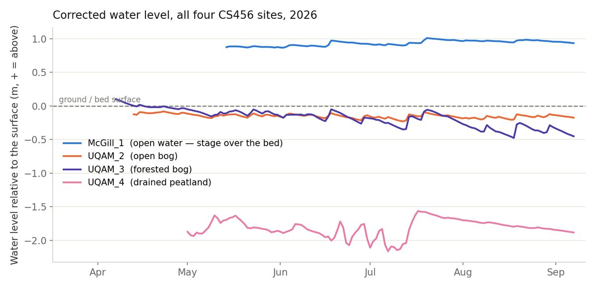
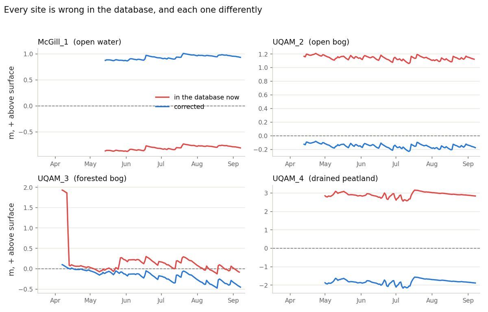
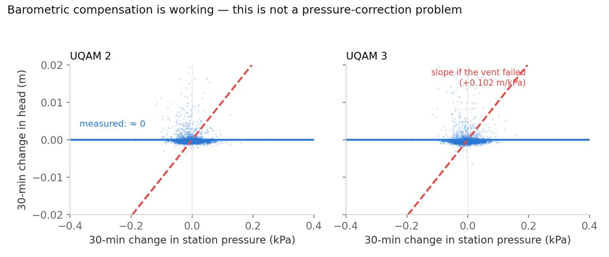
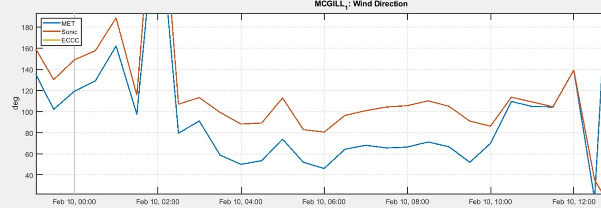
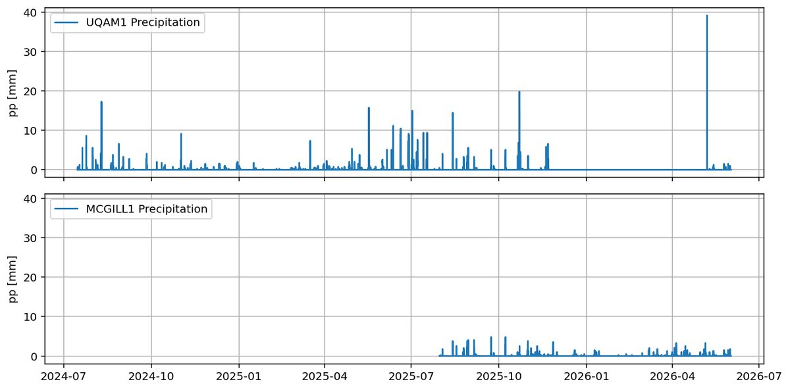
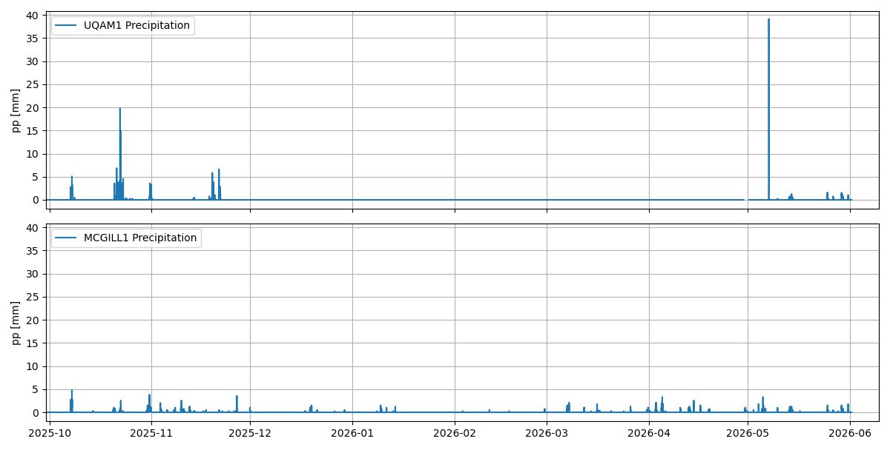
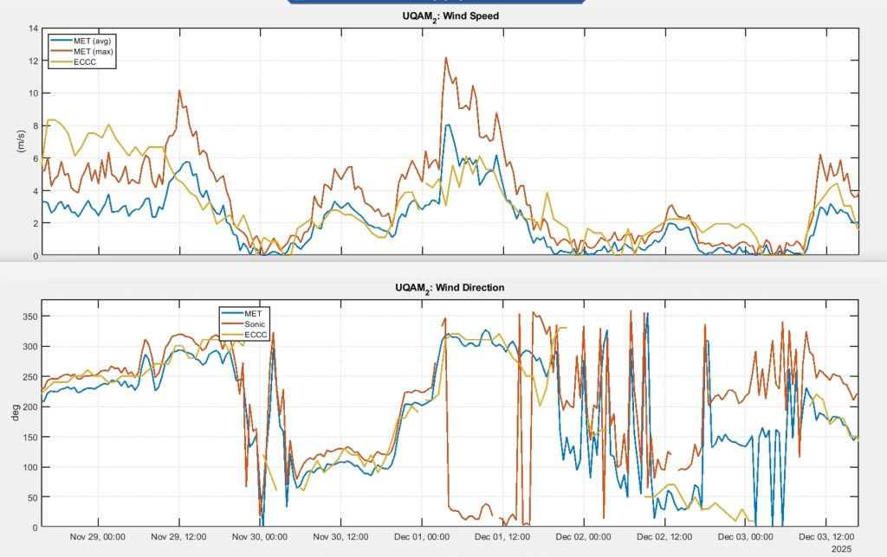
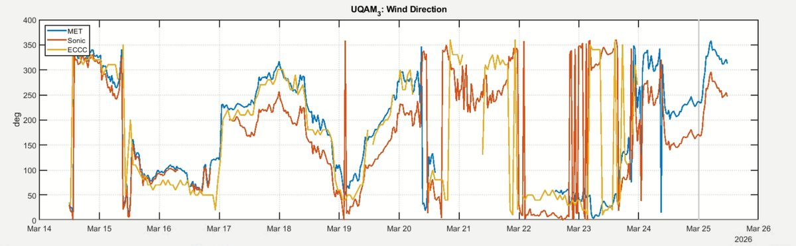

# Data caveats (data-pipeline notes)

Known problems in the flux and biomet data that the people processing it need to handle, from David's Word document *Inconsistencies, issues and sensor changes in the stations to tackle on the data pipeline* plus later analysis. 19 entries; 18 open, 1 resolved. Each entry has: the site it affects (or ALL), the edition date it was noted, the affected period, what happened, how to handle it, a cross-check against the field notes (agrees) or a **Needs confirming** flag (field notes disagree or a detail is doubtful), links, plots and the TraceAnalysis ini files that carry the fix.

## Index

| ID | Site | Title | Period | Noted | Status |
|---|---|---|---|---|---|
| pn1 | ALL | LI-7200 intake tube settings are wrong in the metadata | All data to date | 2026-06-01 | Resolved 2026-10-16 |
| pn13 | ALL | Water table depth: every CS456 datum is wrong, and the offset lives in the logger | Every CS456 installed to date | 2026-09-23 | Open |
| pn19 | ALL | Water table sensors and water probes are disconnected every winter | Every winter, from the fall removal to the spring reinstallation | 2026-09-29 | Open |
| pn3 | McGill_1 | Wind monitor misalignment | Installation → 2026-02-10 10:30 | 2026-04-13 | Open |
| pn4 | McGill_1 | TW_5_1_1 renamed TW_1_5_1 in the logger on 2026-09-28 | 2025-09-25 → 2026-09-28 11:30 logged as TW_5_1_1 | 2026-09-29 | Open |
| pn18 | McGill_1 | Open water measured against a datum 1.7 m out | All data to date; CS456 from 2026-05-28 | 2026-09-23 | Open |
| pn2 | UQAM_1 | Tipping bucket damaged: no liquid precipitation record | 2025-11-21 → 2026-05-07 | 2026-06-01 | Open |
| pn5 | UQAM_1 | Canopy height changes through the growing season | Every growing season | 2026-04-13 | Open |
| pn6 | UQAM_1 | New soil sensor variables in the biomet | From 2025-08-05 | 2026-04-13 | Open |
| pn7 | UQAM_1 | Wrong sensitivity used for HFP01_1_1 | All data to date | 2026-04-13 | Open |
| pn8 | UQAM_2 | Station struck by lightning: data gap | 2025-05-25 → 2025-07-08 | 2026-04-13 | Open |
| pn9 | UQAM_2 | Eddy boom moved by a storm | 2025-12-17 03:30 → 14:00 | 2026-04-13 | Open |
| pn14 | UQAM_2 | WTD datum was 1.3 m short | 2026-04-27 → present (all CS456 data) | 2026-09-23 | Open |
| pn16 | UQAM_2 | Deepest soil profile probe: 45 cm or 64 cm? | All soil profile data | 2026-09-22 | Open |
| pn10 | UQAM_3 | Wind monitor not properly aligned | Installation → 2025-08-26 14:00 | 2026-04-13 | Open |
| pn11 | UQAM_3 | Eddy boom moved by intense winds | From 2026-03-17 03:30 | 2026-04-13 | Open |
| pn15 | UQAM_3 | Three different datums in one season | 2026-04-21 → present (all CS456 data) | 2026-09-23 | Open |
| pn12 | UQAM_4 | Dynamic metadata and wind sector filtering needed | Every growing season | 2026-04-13 | Open |
| pn17 | UQAM_4 | WTD came from the EasyProbe, and the CS456 datum has the wrong sign | All data to date; CS456 from 2026-05-15 | 2026-09-23 | Open |

## pn1 · LI-7200 intake tube settings are wrong in the metadata

- **Site:** All towers
- **Affected period:** All data to date
- **Noted (edition):** 2026-06-01
- **Status:** Resolved on 2026-10-16 — Marked as already handled by David on 2026-10-16.

### What happened

Every tower (UQAM_1, McGill_1, UQAM_2, UQAM_3 and UQAM_4) carries a LI-7200 tube length of 100 cm and the settings of an *insulated* intake tube in its metadata, but the heated intake tubes are what is actually installed. The parameters that should be used instead are:

- Intake tube inside diameter: **5.33 mm** (0.21")
- Intake tube outside diameter: **6.35 mm** (0.25")
- Intake tube length: **71.1 cm** (28")

### How to handle it

This difference can affect the flux calculations, so apply these values in the EddyPro runs rather than reading the settings from the ghg files.

### Links

- [LI-7200RS specifications](https://www.licor.com/support/LI-7200RS/topics/specifications.html)

## pn13 · Water table depth: every CS456 datum is wrong, and the offset lives in the logger

- **Site:** All towers
- **Affected period:** Every CS456 installed to date
- **Noted (edition):** 2026-09-23
- **Status:** Open
- **Fixed in ini files:** [UQAM_2_FirstStage.ini](ini/UQAM_2_FirstStage.ini), [UQAM_2_SecondStage.ini](ini/UQAM_2_SecondStage.ini), [UQAM_3_FirstStage.ini](ini/UQAM_3_FirstStage.ini), [UQAM_3_SecondStage.ini](ini/UQAM_3_SecondStage.ini), [UQAM_4_FirstStage.ini](ini/UQAM_4_FirstStage.ini), [UQAM_4_SecondStage.ini](ini/UQAM_4_SecondStage.ini), [MCGILL_1_FirstStage.ini](ini/MCGILL_1_FirstStage.ini), [MCGILL_1_SecondStage.ini](ini/MCGILL_1_SecondStage.ini)

### What happened

**The sign convention is settled.** AmeriFlux's measurement-height page states that *"positive values are heights, and negative values are depths"*, so for WTD: **positive = water above the surface, negative = below it**. That is the sign the CR1000X already produces: `Lvl_m = Lvl_psi*0.70307 - WTD_offset`, where the first term is the height of water above the transducer and `WTD_offset` is the sensor's depth below the surface. The logger's arithmetic was never the problem.

**The offsets were.** Not one of the four sites had a datum that survives contact with a tape measure, and each is wrong in a different way:

| Site | Offset in the cal file | What that implies | True sensor depth |
| --- | --- | --- | --- |
| UQAM_2 | 0.79 m | water 1.1 m *above* an open bog, all season | 2.05 m (measured) |
| UQAM_3 | 0.00 → 1.75 → 1.48 m | three different datums in one season, none right | 1.83 m |
| UQAM_4 | −1.57 m | water 2.9 m above a drained peatland | 3.15 m (disputed) |
| McGill_1 | 1.58 m | 0.8 m of water *below* the bed, at an open-water site under a metre of it | −0.16 m |

Two problems follow from applying the offset inside the logger. First, only the corrected value carries meaning and nothing records which offset was in force on which date: the history above had to be recovered by differencing the archived `Lvl_psi_Avg` against `Lvl_m_Avg`. Second, an offset can be tuned to agree with a field tape at exactly one instant and still be wrong everywhere else, which is what happened at UQAM_3 on 10 June.

Barometric compensation was suspected and is **not** the problem: the CS456 is a vented gauge sensor and `aM1!` returns psig. Regressing 30-minute changes in head against 30-minute changes in station pressure gives a slope within 0.01 m/kPa of zero at both bog sites, against +0.102 for a sensor with no vent compensation.

### How to handle it

Change the logger line to publish raw head only (`Lvl_m = Lvl_psi*0.70307`) and apply the datum in first stage as a dated calibration: `currentCalibration = [0.70307 -<sensor_depth_below_surface> datenum(start) datenum(2999,12,31)]`. A negative depth is legitimate where the sensor hangs above the bed, as at McGill_1. That makes a datum correction retroactive and reviewable instead of stamping a step into the record, and since `Lvl_psi_Avg` is archived everywhere the whole 2026 season can be rebuilt without losing anything. Reprocess all four sites for 2026 and re-export to AmeriFlux. UQAM_1 also has a CS456 with three weeks of data in May 2026 and an offset of 1.17 m that nobody has checked.

### Cross-check against the field notes

UQAM_3's CS456 went in on 2026-04-15 and UQAM_4's on 2026-05-15 (SN 70010299), both recorded in the field notes. McGill_1's was added on 2026-05-28, during the visit that chased the battery-logger communication fault.

### Needs confirming

UQAM_2's CS456 appears in no EcoFlux field note. Its data start on 2026-04-27, the day of the 'Maintenance and SmartFlux upgrade' visit, so it was almost certainly installed then. The sensor depth (2.05 m) and the water table at installation (0.13 m below the surface) are in a written installation note; adding that note to EcoFlux would close this.

### Links

- [AmeriFlux measurement height and sign convention](https://ameriflux.lbl.gov/data/measurement-height/)
- [CS451/CS456 manual (Table 8-3: aM1! returns psig)](https://s.campbellsci.com/documents/us/manuals/cs451-cs456.pdf)

### Plots

*The corrected record. The four sites separate exactly as their ecology predicts: an open-water site held near +0.9 m, two bogs tracking the surface through a summer drawdown, and a drained agricultural peatland pinned near −1.8 m.*

*What is in the database today (red) against the corrected series (blue). McGill_1 and UQAM_4 are the clearest: an open-water site under a metre of water is recorded as 0.8 m drained, and a drained peatland as 2.9 m flooded.*

*Barometric compensation test at the two bog sites. Each dot is one 30-minute interval. If a vent tube were blocked or the desiccant spent, the cloud would tilt onto the dashed red line; it does not.*

## pn19 · Water table sensors and water probes are disconnected every winter

- **Site:** All towers
- **Affected period:** Every winter, from the fall removal to the spring reinstallation
- **Noted (edition):** 2026-09-29
- **Status:** Open

### What happened

At every site the CS456 pressure transducers (`WTD_1_1_1`) and the Eureka EasyProbe water multiprobes (water temperature, conductivity, dissolved oxygen, ORP, pH and level) are disconnected for the winter, because they get damaged when the water gets close to 0 °C. Whatever these channels record between the fall removal and the spring reinstallation is not a measurement of the water.

### How to handle it

Exclude each removal-to-reinstallation window in first stage, one dated window per winter and per sensor, rather than relying on the min/max limits to catch it. Each reinstallation changes the transducer's position, so the WTD datum has to be re-measured at every spring reinstallation and entered as a new dated `currentCalibration` row (see the water table caveat above); the previous season's offset does not carry over. Write the removal and reinstallation dates, and the new sensor depth, in the field note of that visit.

### Cross-check against the field notes

The field notes record one winter removal so far: the McGill_1 EasyProbe, taken out on 2025-11-10 for the freezing risk and reinstalled on 2026-04-23. Every CS456 went in during spring 2026 (UQAM_3 on 2026-04-15, UQAM_2 from 2026-04-27, UQAM_1 on 2026-05-07, UQAM_4 on 2026-05-15, McGill_1 on 2026-05-28), so the coming winter is the first one for them. The UQAM_1 EasyProbe stayed in during the 2024–25 winter and was found frozen inside its pipe in January 2025.

## pn3 · Wind monitor misalignment

- **Site:** McGill_1
- **Affected period:** Installation → 2026-02-10 10:30
- **Noted (edition):** 2026-04-13
- **Status:** Open

### What happened

The Young wind monitor was installed incorrectly. Its reference was looking at 220° instead of 180°, so wind direction was offset until it was corrected at 10:30 on 10 February 2026.

### How to handle it

Correctable in the First Stage with an offset.

### Needs confirming

The source document describes this as "a 30° difference", but 220° − 180° is 40°. Worth confirming which figure is right before applying the offset.

### Plots

*McGill_1 wind direction, MET vs. sonic, around the 10 February 2026 correction. The two series converge after the grey marker.*

## pn4 · TW_5_1_1 renamed TW_1_5_1 in the logger on 2026-09-28

- **Site:** McGill_1
- **Affected period:** 2025-09-25 → 2026-09-28 11:30 logged as TW_5_1_1
- **Noted (edition):** 2026-09-29
- **Status:** Open
- **Fixed in ini files:** [MCGILL_1_FirstStage.ini](ini/MCGILL_1_FirstStage.ini), [MCGILL_1_SecondStage.ini](ini/MCGILL_1_SecondStage.ini)

### What happened

The deepest water thermocouple of the profile (5 cm above the bottom) was logged as `TW_5_1_1`, which reads as a horizontal replicate. It belongs to the vertical profile, below `TW_1_4_1`, so its name is `TW_1_5_1` (first noted 2026-04-13). The logger program was changed on **2026-09-28 at 11:40 EST**: the 12:00 half-hour average is the first record written as `TW_1_5_1`, and everything before it is under `TW_5_1_1`.

### How to handle it

Handled in first stage, not by editing the raw files: a single trace `TW_1_5_1` reads `TW_5_1_1_Avg` up to the 11:30 record and `TW_1_5_1_Avg` from the 12:00 record, through two rows of `inputFileName_dates`. The switch is set at 11:45, between two half-hour records, so no record is claimed by both names. Second stage passes `TW_1_5_1` through, so no `TW_5_1_1` reaches AmeriFlux.

### Cross-check against the field notes

The profile was installed on 2025-09-25 (the pipe stopped at −20 cm, so the −50 cm sediment sensor could not go in) and its wires were sorted on 2026-05-28. The rename was done in the logger program and has no field note.

### Needs confirming

Two things to check before committing the ini. (1) The logger column names are assumed to be `TW_5_1_1_Avg` and `TW_1_5_1_Avg`, following the `_Avg` pattern of the other traces: check them against the Met file headers. (2) The rest of the profile is not in the McGill_1 first stage yet. `TW_1_1_1` there is the EasyProbe water temperature (`T_WATER_Avg`), which clashes with the thermocouple `TW_1_1_1` (100 cm above the bottom); `TW_1_2_1` to `TW_1_4_1` have no trace; and `TS_1_1_1` to `TS_1_4_1` are described as CS650 at 8, 16, 32 and 64 cm, while the site has thermocouples at 5, 10 and 20 cm and no usable `TS_1_4_1`.

## pn18 · Open water measured against a datum 1.7 m out

- **Site:** McGill_1
- **Affected period:** All data to date; CS456 from 2026-05-28
- **Noted (edition):** 2026-09-23
- **Status:** Open
- **Fixed in ini files:** [MCGILL_1_FirstStage.ini](ini/MCGILL_1_FirstStage.ini), [MCGILL_1_SecondStage.ini](ini/MCGILL_1_SecondStage.ini)

### What happened

McGill_1 is open water. Its CS456 is a **stage sensor** reading the depth of the water column over the lake bed, not a well in soil: there is no unsaturated zone, so the value is positive all season by construction and the sign convention never bites here. The datum does.

Two faults. First, `WTD_1_1_1` was sourced from `L_WATER_Avg`, the EasyProbe level channel, with no date limit, so the pre-CS456 record is EasyProbe level standing in for water depth. Second, since the CS456 was added on 28 May the cal file has carried `WTD_offset = 1.58 m`, which reports **0.73 to 0.88 m of water below the bed at a site standing under about a metre of it**: out by roughly 1.7 m.

At installation there was 0.87 m of water above the bed and head averaged 0.7109 m, so the transducer sits **0.16 m above** the bed, on its mount in the water column. Its depth relative to the reference surface is therefore negative. That is the normal case for a stage sensor and not a sign error: the arithmetic is unchanged, `WTD = head − depth`, so a negative depth adds rather than subtracts. Corrected, the season runs +0.87 to +1.01 m: a lake level creeping up about 14 cm through the summer.

### How to handle it

Source `WTD_1_1_1` from `Lvl_psi_Avg` with `currentCalibration = [0.70307 0.16 datenum(2026,5,28) datenum(2999,12,31)]` (a positive calibration offset because the sensor depth is negative) starting the trace at 2026-05-28 11:00. The CS456 serial number is recorded nowhere and should be added.

### Cross-check against the field notes

The 2026-05-28 field note records the CS456 being added during the visit that chased the battery-logger communication fault.

### Needs confirming

Three things. (1) The installation was reported as reading 1.1265 psi, but the archive holds 1.0098–1.0133 psi across the whole of 28 May and does not exceed 1.10 psi before 2 July; the archived value is used here, and if 1.1265 psi is right the depth becomes −0.08 m instead, an 8 cm difference. (2) The field note reasons that "values are negative because the water sits above ground: this is correct". Under the AmeriFlux convention that is backwards: water above the surface is positive. (3) Worth confirming the BASE name before the next upload. `WTD` is defined as water table depth and this is a surface-water stage measurement; wetland sites commonly report standing water under `WTD` as a positive value, which is what is done here, but if AmeriFlux has a dedicated surface-water variable it belongs there. The number does not change either way, only the label.

## pn2 · Tipping bucket damaged: no liquid precipitation record

- **Site:** UQAM_1
- **Affected period:** 2025-11-21 → 2026-05-07
- **Noted (edition):** 2026-06-01
- **Status:** Open

### What happened

The tipping bucket was damaged on 2025-11-21 and not repaired until 2026-05-07. It was damaged repeatedly over that period, and it was winter, so there are no records of liquid precipitation. On the day it was repaired there is an artificial spike that was produced for testing.  
  
McGill_1 sits a few kilometres from UQAM_1, so its precipitation record is plotted alongside to show how the data were affected.

### How to handle it

Treat the whole window as missing rather than zero precipitation, and discard the test spike on 2026-05-07.

### Plots

*UQAM_1 and McGill_1 precipitation, full record. The UQAM_1 gap from late 2025 and the isolated 39 mm test spike in May 2026 are both visible.*

*The same two series zoomed to 2025-10 → 2026-06, where McGill_1 keeps recording through the UQAM_1 outage.*

## pn5 · Canopy height changes through the growing season

- **Site:** UQAM_1
- **Affected period:** Every growing season
- **Noted (edition):** 2026-04-13
- **Status:** Open

### What happened

UQAM_1 is an agricultural field, so canopy height changes continuously through the growing season rather than staying at the fixed value in the metadata. Manual measurements are available to complement the canopy height estimations.

### How to handle it

Use dynamic metadata for canopy height rather than a single static value.

### Links

- [Canopy height measurements (SharePoint)](https://uqam.sharepoint.com/:f:/r/sites/CARBONIQUE/Documents%20partages/Data/UQAM_1/Canopy%20height?csf=1&web=1&e=GKHo8q)

## pn6 · New soil sensor variables in the biomet

- **Site:** UQAM_1
- **Affected period:** From 2025-08-05
- **Noted (edition):** 2026-04-13
- **Status:** Open

### What happened

Horizontal replicas of the CS650 sensor were installed, so from 2025-08-05 onwards there are new variables in the biomet file:

- CS650 **SN 61406** (`TS_2_1_1`, `SWC_2_1_1`
- CS650 **SN 61439**) `TS_3_1_1`, `SWC_3_1_1`
- CS650 **SN 61429** (`TS_4_1_1`, `SWC_4_1_1`
- CS650 **SN 61414**) `TS_5_1_1`, `SWC_5_1_1`

### How to handle it

Expect the column set to change on 2025-08-05; do not treat the new variables as errors.

## pn7 · Wrong sensitivity used for HFP01_1_1

- **Site:** UQAM_1
- **Affected period:** All data to date
- **Noted (edition):** 2026-04-13
- **Status:** Open

### What happened

`HFP01_1_1` has been using the wrong sensitivity throughout. The calibration file shows **62.15** where it should be **60.15 V/(W/m²)**. Because the logger computes `HFP() = 1000 · HFP_mV() / HFP_Sens()`, the recorded value is scaled by the ratio of the two sensitivities.

### How to handle it

Re-weight the variable: `G_1_1_1_new = G_1_1_1_from_logger × 62.15 / 60.15`: that is, wrong sensitivity divided by correct sensitivity.

## pn8 · Station struck by lightning: data gap

- **Site:** UQAM_2
- **Affected period:** 2025-05-25 → 2025-07-08
- **Noted (edition):** 2026-04-13
- **Status:** Open

### What happened

Expect missing data between 25 May 2025 and 8 July 2025: lightning hit the tower. Improving the grounding and lightning protection systems took time before the sensors could be reinstalled.

### How to handle it

Treat the window as a hardware outage, not as a measurement.

### Cross-check against the field notes

Matches the maintenance record: grounding was rebuilt on 2025-06-03 and the EC sensors reinstalled and reconfigured on 2025-07-02 and 2025-07-08.

## pn9 · Eddy boom moved by a storm

- **Site:** UQAM_2
- **Affected period:** 2025-12-17 03:30 → 14:00
- **Noted (edition):** 2026-04-13
- **Status:** Open

### What happened

A storm damaged some sensors and moved the eddy boom at 03:30 on 17 December 2025, turning it from 264° to 315°. The whole system was reinstalled and realigned at 14:00 the same day. The sonic anemometer was not damaged, but it measured with that different offset for the intervening period.

### How to handle it

Include dynamic metadata in EddyPro and modify the north offset, plus the northward and eastward distances between the eddy sensors, for that window.

### Needs confirming

The maintenance note for the 2025-12-17 visit places the boom movement "around midnight Dec 1st" in the data, and the plot below spans 29 Nov – 3 Dec 2025: neither matches a 17 December event. The affected window may be considerably longer than stated; worth resolving before applying dynamic metadata.

### Plots

*UQAM_2 wind speed and direction, 29 Nov – 3 Dec 2025. MET and sonic directions track each other until 1 December, then diverge sharply.*

## pn14 · WTD datum was 1.3 m short

- **Site:** UQAM_2
- **Affected period:** 2026-04-27 → present (all CS456 data)
- **Noted (edition):** 2026-09-23
- **Status:** Open
- **Fixed in ini files:** [UQAM_2_FirstStage.ini](ini/UQAM_2_FirstStage.ini), [UQAM_2_SecondStage.ini](ini/UQAM_2_SecondStage.ini)

### What happened

UQAM_2 ran on `WTD_offset = 0.79 m` from installation and the value was never changed or checked. With the head above the sensor sitting at 1.84–2.01 m all season, the database says the water table has been **1.06 to 1.21 m above the surface of an open bog** continuously since April.

The written installation note records the sensor at **2.05 m** below the surface and the water table 0.13 m below it. The archive starts 2026-04-27 13:30 and the sensor was still equilibrating that evening, its head climbing from 1.41 to 1.95 m; by 2026-04-28 00:00 it had settled at 1.9533 m, which with the measured depth puts the water table 0.10 m below the surface, 3 cm above the installation reading, as expected while a freshly augered hole recovers. An independent estimate, the offset that would place the wettest 1 % of the record exactly at the surface, gives 2.00 m: 5 cm away. (Before the written note turned up, the depth had been tied to the settled reading instead, which gave 2.08 m.)

Corrected, the season runs −0.20 to −0.05 m: a very wet bog whose water table barely moves, which matches its 6–9 °C water temperature and its weak evapotranspiration signal.

### How to handle it

Source `WTD_1_1_1` from `Lvl_psi_Avg` with `currentCalibration = [0.70307 -2.05 datenum(2026,4,28) datenum(2999,12,31)]` and start the trace on 2026-04-28, after the equilibration transient.

### Cross-check against the field notes

The data begin on 2026-04-27, the day of the SmartFlux upgrade visit. The written installation note gives the sensor depth (2.05 m) and the water table at installation (0.13 m below the surface).

## pn16 · Deepest soil profile probe: 45 cm or 64 cm?

- **Site:** UQAM_2
- **Affected period:** All soil profile data
- **Noted (edition):** 2026-09-22
- **Status:** Open

### What happened

`UQAM_2_FirstStage.ini` states that the deepest CS650 in the Soil-3 profile is at **45 cm**, SN 61425, and says explicitly that the 64 cm figure was copied from UQAM_1. The field note of 2026-08-20, which rechecked every probe location and serial number on site, records the same serial at **64 cm**: `7H SN61425 (64cm)`. The other three depths agree in both sources (8, 16 and 32 cm, SN 61438 / 61418 / 61426).

The 2025 temperature record favours 64 cm. Fitting the annual wave's amplitude decay across the four depths gives a damping depth that, divided by √365, should equal the damping depth measured independently from the summer daily wave between 8 and 16 cm. With the deepest probe at 64 cm the two agree to 1.6 % (12.7 cm predicted, 12.9 cm observed); at 45 cm they disagree by 36 %. The 2026 season is only two-thirds complete, so its annual amplitude is biased and the same test there is inconclusive.

### How to handle it

Do not change the ini on the strength of the temperature test alone: settle it with a tape on the next visit and then correct whichever source is wrong. Meanwhile treat `TS_4`, `SWC_1_4_1` and the other `*_1_4_1` traces at UQAM_2 as being at an uncertain depth between 45 and 64 cm.

### Needs confirming

The ini and the 2026-08-20 field note give different depths for the same serial number (61425). The ini's note that 45 cm replaced a value copied from UQAM_1 suggests somebody deliberately corrected it, but the field check that followed four months later recorded 64 cm. One of the two is wrong and the data lean towards 64 cm.

## pn10 · Wind monitor not properly aligned

- **Site:** UQAM_3
- **Affected period:** Installation → 2025-08-26 14:00
- **Noted (edition):** 2026-04-13
- **Status:** Open

### What happened

The wind monitor was never correctly aligned after installation: it was looking at 300°. It was corrected to 180° (reference) at 14:00 on 26 August 2025.

### How to handle it

Apply a direction offset to everything before that timestamp.

### Cross-check against the field notes

Confirmed by the maintenance note of 2025-08-26, which records the box found at 300° from north and reoriented to face south.

## pn11 · Eddy boom moved by intense winds

- **Site:** UQAM_3
- **Affected period:** From 2026-03-17 03:30
- **Noted (edition):** 2026-04-13
- **Status:** Open

### What happened

Intense winds moved the eddy boom at 03:30 on 17 March 2026, from 264° to 315°. The sonic anemometer was not damaged, but it measured with that different offset during the period.

### How to handle it

Include dynamic metadata in EddyPro and modify the north offset, plus the northward and eastward distances between the eddy sensors, for that window.

### Needs confirming

Three details in this entry look copied from the UQAM_2 one and need checking: the realignment is given as "2pm on December 17th, 2025", which is before the event; the angles 264° → 315° are identical to UQAM_2's; and the maintenance record says the UQAM_3 boom was found at 60° instead of its usual 332° and was re-clamped on 2026-03-27, not in March 17–December. The end of the affected window is therefore probably 2026-03-27.

### Plots

*UQAM_3 wind direction, 14–26 March 2026. MET and sonic diverge from around 17 March onward.*

## pn15 · Three different datums in one season

- **Site:** UQAM_3
- **Affected period:** 2026-04-21 → present (all CS456 data)
- **Noted (edition):** 2026-09-23
- **Status:** Open
- **Fixed in ini files:** [UQAM_3_FirstStage.ini](ini/UQAM_3_FirstStage.ini), [UQAM_3_SecondStage.ini](ini/UQAM_3_SecondStage.ini)

### What happened

UQAM_3 has run on three offsets: `0.00 m` from 21 April (the cal file had not loaded, so the logger was publishing raw head under a WTD name), `1.75 m` from 27 April, and `1.48 m` from 10 June. None is right.

On 10 June the water table was measured at **0.115 m below the surface** and the offset was set to 1.48 so the logger would display a number near it. Head that day averaged 1.7162 m, so the sensor actually sits **1.83 m** below the surface. The half-hourly record even catches the visit: a single disturbance spike at 10:30, the cal file rewritten around 11:00, and one record caught mid-write at 1.50 m.

Corrected, the season runs +0.11 m in April (about 11 cm of ponding at snowmelt) down to −0.49 m by mid-September, tracking the 39 cm fall in head over the same period.

### How to handle it

Source `WTD_1_1_1` from `Lvl_psi_Avg` with `currentCalibration = [0.70307 -1.83 datenum(2026,4,21) datenum(2999,12,31)]`, starting the trace at 2026-04-21 16:00 once the sensor had settled. Do not reprocess 21–27 April from `Lvl_m_Avg`: no offset was loaded then.

### Cross-check against the field notes

The CS456 was installed on 2026-04-15 and a site visit is recorded for 2026-06-10, consistent with the disturbance spike in the pressure record at 10:30 that day.

### Needs confirming

The 10 June reading was first reported as 0.24 m and later as 11.5 cm rounded to 12 cm. The two give sensor depths of 1.96 m and 1.83 m respectively: a 13 cm difference that shifts the whole series. 1.83 m is used here, per the later and more precise figure, but it is worth confirming which reading the field sheet records.

## pn12 · Dynamic metadata and wind sector filtering needed

- **Site:** UQAM_4
- **Affected period:** Every growing season
- **Noted (edition):** 2026-04-13
- **Status:** Open

### What happened

UQAM_4 will potentially also need dynamic metadata to track the canopy change as the crops grow. The site is also not ideally located, because of restrictions imposed by the landowner, so wind coming from the direction of the trees will potentially need to be filtered out.

### How to handle it

Plan for a canopy-height time series and a wind-sector filter over the treed fetch.

### Links

- [Site location (Google Maps)](https://maps.app.goo.gl/nNaJoognyg1s2uSXA)

## pn17 · WTD came from the EasyProbe, and the CS456 datum has the wrong sign

- **Site:** UQAM_4
- **Affected period:** All data to date; CS456 from 2026-05-15
- **Noted (edition):** 2026-09-23
- **Status:** Open
- **Fixed in ini files:** [UQAM_4_FirstStage.ini](ini/UQAM_4_FirstStage.ini), [UQAM_4_SecondStage.ini](ini/UQAM_4_SecondStage.ini)

### What happened

Two faults. First, `WTD_1_1_1` was sourced from `L_WATER_Avg` (the EasyProbe level channel) with no date limit, at a site whose EasyProbe has no water table sensor. Second, since the CS456 went in on 15 May the cal file has carried `WTD_offset = −1.57 m`, a negative depth for a buried sensor, which puts the water table **2.6 to 3.2 m above the surface of a drained agricultural peatland**.

Water was found at 1.85 m depth at installation. Head had settled at 1.297 m by 12:59 that day, which implies a sensor depth of **3.15 m** and a season running −1.56 to −2.16 m.

### How to handle it

Source `WTD_1_1_1` from `Lvl_psi_Avg` with `currentCalibration = [0.70307 -3.15 datenum(2026,5,15) datenum(2999,12,31)]`, starting the trace on 2026-05-16 so the day the hole was still filling is excluded. If the depth turns out to be 2.70 m, change the two numbers and the season reads −1.10 to −1.75 m instead.

### Cross-check against the field notes

The installation note of 2026-05-15 records the CS456 (SN 70010299), water at 1.85 m and a hole going down to 270 cm, with the remark that readings below that value are not valid.

### Needs confirming

A sensor cannot sit 3.15 m down a 2.70 m hole. The likeliest reading is that 1.85 m is where water was first struck while augering rather than the settled water table: the record starts at 10:30 with a head of only 0.169 m and fills through the day, which is the hole recovering. Measure the cable drop on the next visit; until then the UQAM_4 datum is provisional to about 0.45 m.
